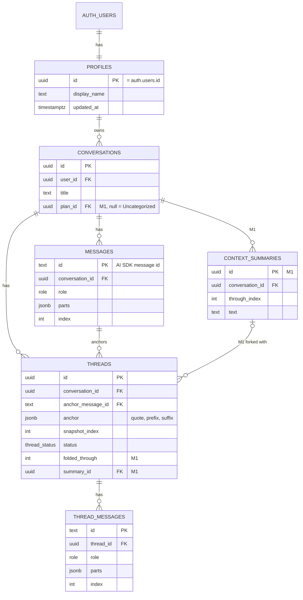

# funlern working doc

Shared copy: https://claude.ai/code/artifact/c40870de-a8d2-482f-8c9c-b1bdfd36cc17. Keep both in sync.

## Overview

funlern is an interactive learning app, not a general chat clone. You start by saying what you want to learn, set a minimal goal, then work through it: highlight any passage to ask about it in a side thread, answer clarifying questions and pop quizzes as cards, and earn progress as you go. The first user is me, learning faster; it doubles as a showcase.

Status as of 2026-10-10: sign in, start a conversation and chat with Claude, saved to Postgres, all running locally on `supabase start`. The thread API exists; the thread UI (highlight, Ask popover, rail) is next. Committed on `feat/scaffold` (1651ff2), not pushed.

## Scope and milestones

Three milestones: the POC proves side threads, the MVP adds the learning loop, and everything else waits until I have used it for real.

| Milestone | In scope | Done when |
| --- | --- | --- |
| M0 POC | Highlight to ask, side-thread rail, side questions folded into main, Claude only | I can pick apart one long answer with three or more threads |
| M1 MVP | Learning setup, ask-user cards, context compaction | I use it for a week instead of Claude chat for one topic |
| Later | Pop quizzes, XP and streak, free-text grading, spaced review of missed concepts, concept mastery map, shareable sessions for the showcase, selectable tutor avatars (unlocked with XP first, paid later), bring-your-own models (DeepSeek, Kimi, GLM, OpenRouter) | Picked after M1 |
| Pinned | Web search tool with cited sources (see Web search) | Scheduled once a topic I study needs facts newer than the model's cutoff |

### Plans

Agreed 2026-10-20. Chat sessions live in a **plan**; chats without one are listed as Uncategorized. A plan is the golden path. Training is a layer on top of learning: every plan learns, and a plan trains only once it has `training.md`.

- **Wizard (form first, no name field):** what you want to learn, why, level (new, some, comfortable), how serious (casual, steady, serious plus an optional deadline), optional material. The tutor drafts `brief.md` and `syllabus.md` and the title from it; rename later.
- **Docs, fixed headings:** `brief.md` (Goal, Why, Level, Seriousness, Constraints); `syllabus.md` (Units as a checklist, each may cite material; Notes); `training.md` (Method, Rubric, Log, Next). Learner and tutor fill them together. Every save is a new version; restore copies an old one forward.
- **Material (agreed 2026-10-20):** your own uploads (PDF, Markdown) or pasted text: curricula, prep docs, past questions, resume and stories. At most 5 files and about 30k tokens per plan, so no embeddings, sections or `read_material`: the extracted text goes into the system prompt beside the docs and is cached. Upload once, extract once (pdf.js text layer; a one-time Claude transcription for scanned pages); the original stays in private Storage and the Material tab shows the extracted text. Files are write-once: no editing, no re-extraction; to change one, delete it and add another. Deleting is soft, so running sessions keep their pinned material; sessions pin their material list at start, and additions (full text) or removals (a short note) fold into the next learner message like doc edits.
- **Sessions:** "New learning session" or "New training session (guided, full or card drill)". Mode and style are fixed at creation. Quizzes, study guides and threads stay session-scoped.
- **Tutor writes freely**, one section at a time with `update_doc`, only at natural points (after quiz results, at the end of a rep, when asked). Each write shows a note in the chat and is undoable from history.
- **Context:** the system prompt is built from the docs at the versions pinned when the session started, so it stays cached; threads use the same one. Your edits, and writes from other sessions, reach a running session as `<plan_updated>` with only the changed sections, on your next message (like side questions). The tutor's own writes are already in its history.
- **Reps:** the tutor's answer key goes through `set_rep_key` into `session_secrets`; the saved call keeps the key for the model and is stripped from the stream and page loads. `log_rep` appends the Log row, replaces Next and reveals the key. The log grows without limit for now.
- **Trainer principles (proposed 2026-10-20):** a learner may not know what to rep; working that out is part of the skill, so the tutor helps. Training sessions and mission control (which sets training up) carry a short list of coaching principles distilled from a practice scheme built by hand: measure before teaching, find the one cause behind the misses, small reps with a fixed output and the comfortable dodge ruled out, pass/fail marks decided before reading the answer, assisted kept apart from unaided, progress only on unseen prompts with an exit test per stage, a Log row for every rep, a floor over a schedule, and the learner owns Method and Rubric. Setup asks whether the tutor should design the Method and Rubric itself (from one or two cold attempts, or from the brief) or build them with the learner. Principles first; worked examples only if the principles fall short.
- **Mission control (first version built 2026-10-20):** each plan has one continuous session for adjusting the plan itself, at `/p/[id]/mc`, opened from the plan page. There are no new sessions: you always return to the same one. Creating a plan lands there: it shows what the wizard drafted (brief, syllabus, material), says what you can change, and offers training setup when it fits. It may edit all three docs, including `training.md`. Open questions: the session never ends, so it needs compaction before it gets long; and its system prompt can't stay pinned to the docs it started with forever, so it either re-pins on each visit (one cold cache per visit) or relies on `<plan_updated>` folds.
- **Defaults taken (change any):** rep style fixed at start; plan sessions use `toolChoice: 'auto'` and `ask_user` leaves the tool set until its card exists; deleting a plan moves its sessions to Uncategorized; material capped at 5 files and about 30k tokens per plan.

### Ask-user cards and quizzes

Both are AI SDK tools with no server `execute`: the model calls them and the client renders a card, like Claude's multiple-choice prompt.

- **`ask_user`**: a question with 2 to 4 options (label + one-line description), plus "something else" and skip. The answer goes back with `addToolOutput`; `sendAutomaticallyWhen` continues the turn.
- **`create_quiz`**: server tool. 1 to 5 questions (question, four choices, correct index, explanation), saved to `quizzes` / `quiz_questions`. The card never gets the answer key: the server grades each pick (`quiz_answers`) and sends the results back to the tutor when the quiz ends.
- **Answer key on the client:** acceptable for a single-user learning app. Strip it from the stream later if sessions become shared.

### Free-text answers

Later, with quizzes. The model grades each answer as correct, partially correct or incorrect. To keep grading consistent:

1. **Key points first.** When the model writes the question, it also writes 2 to 4 key points a good answer must cover. They stay hidden from the card.
2. **Separate grader call.** Grading runs without the conversation, so the model is not inclined to be generous to the user it has been teaching. It sees only the question, the key points and the answer, at temperature 0, with structured output.
3. **Score from the points.** The grader marks each key point covered or missing; the app maps all covered to correct, some to partially correct, none to incorrect.
4. **Show the reasoning.** The card shows which points were missed, and a "I think I'm right" button regrades or lets me override.

Known weak spots: answers that sound confident but are wrong, long answers scored higher than they deserve, and weaker open-weight models as graders. The grader model is configurable for that reason.

### When quizzes appear

The app sets the cadence; the model writes the quiz. With "occasional", every 4th assistant turn the server adds one line to that user message: "End with one quiz question on what we just covered." Questions asked in side threads are fed in as hints, because they mark what confused me. The cadence lives in the user message, not the system prompt, so the cached prefix does not change.

### Progress

XP comes only from quizzes: 10 for correct first try, 3 for correct after a miss. A streak counts consecutive days with at least one quiz answered. Both are derived from `quiz_answers`, so there is no stats table to keep in sync. Per-concept accuracy from the same table drives "review this" later.

### What this changes in the build

- **Schema:** plan tables (see Plans and the work tracker); `quizzes`, `quiz_questions`, `quiz_answers` (built); add a concept tag per question for per-concept accuracy.
- **Threads must send the same tool definitions as main.** Tools sit at the front of the cached prefix, so a thread without them misses the cache. Threads set `toolChoice: "none"` instead.

### Web search (pinned)

Pinned, not scheduled. The tutor gets one `web_search` tool that we run ourselves, so it works with every model, including DeepSeek, Kimi and GLM. Provider-built search (Anthropic, OpenAI) only works with that vendor's models.

- **Backend:** Tavily, 1,000 free searches a month, then about $0.008 each. Google Custom Search is closed to new signups and shuts down on 2027-01-01.
- **Tool:** input `{ query }`; returns the top 5 results (title, URL, trimmed content). The server holds the key; bring-your-own search key later.
- **Limits:** a few searches per turn, a daily quota per user, results cached by query in Postgres.
- **Citations:** results render as source chips under the tutor message.
- **Context:** compaction drops old search results and keeps only what was cited.
- **When to search:** the model alone misses confident errors on niche facts, so we steer it: today's date and the model's cutoff in the system prompt, a search eagerness setting per topic, one grounding search when planning a lesson, and a "check this" button.
- **Side threads:** they run with `toolChoice: "none"` today, so they cannot search unless we change that.

## Data model

Five tables are built in code with a generated migration, not yet applied. Table names are plural to match Supabase's `auth.users`. `profiles` is our side of each account: one row per `auth.users` row, created by a signup trigger. Every `user_id` references `profiles`, so deleting a user cascades through all their data. M1 adds two tables and five columns (marked `M1`).

Threads point at both the conversation and the exact message they quote; `snapshot_index` marks where the forked context stops. In M1, `threads.summary_id` records which rolling summary was active when the thread was forked. XP and streaks are derived from `quiz_attempts`.

## Decisions

| Decision | Choice | Why |
| --- | --- | --- |
| Base | Own scaffold (create-next-app) | vercel/chatbot is locked to the AI Gateway, and most of its code is the artifacts feature |
| Chat UI | AI Elements (shadcn registry), restyled | Same components vercel/chatbot uses, without the rest of the app |
| Stack | Next.js 16, Tailwind v4, AI SDK 7, Drizzle | Current versions, all typed |
| Auth + DB | Supabase: email OTP or magic link, Postgres | One service for both |
| Data access | Drizzle as table owner; RLS on with no policies | Blocks the public Data API; every query filters by user id |
| Models | Claude only for the POC, from `ANTHROPIC_API_KEY`: Haiku 5.5 or Sonnet 5.5, picked under the chat bar (cookie, default `ANTHROPIC_MODEL`); bring-your-own models later | One provider key to manage; the removed BYO code is in commit e0f061b |
| Thread context | Frozen fork at the snapshot, same model as main | Shared prefix is a prompt cache hit |
| Thread instructions | In the user turn, not the system prompt | Keeps the cached prefix byte-identical |
| Accounts | Our own `profiles` table keyed to `auth.users`, filled by a signup trigger; table names plural | We own user data like names; plural matches Supabase's `auth.users` |
| Lint | @antfu/eslint-config | `process` stays global for Next env inlining |
| Prompts | TypeScript modules in the repo, versioned by git; no hosted prompt manager | Only developers edit them; typed arguments and diffs come free |
| Migrations | Drizzle generates into `supabase/migrations`; the Supabase CLI applies them. One migration per task, checked by `drizzle-kit check` and squawk | One runner that knows the auth schema; `db reset` and `db push` work locally and on hosted |
| Local dev | `supabase start` in Docker on ports 553xx; hosted values in `.env.remote` | Real Auth and Mailpit locally; 553xx avoids another local Supabase project on the defaults |
| Testing | Vitest for pure logic (anchors, fold, side-question rendering); an opt-in smoke script for the full stack; no component tests yet | Cheap coverage where bugs hide; the smoke test calls Claude, so it stays out of `pnpm test` |
| Tools | Native tool calling via AI SDK `tool()` with zod schemas; one registry, no MCP | Every supported provider has tool calling; zod validates every call |

## Framework comparison

No open-source chat app has highlight-to-ask in a side thread. Keep our own scaffold, use AI Elements for the chat UI, and borrow patterns from LobeHub, big-AGI, LibreChat and NextChat. Researched 2026-10-02 from each repo's code and license.

| Project | License | Stack | Per-user keys | Threads / branching | Highlight or quote | Context compaction |
| --- | --- | --- | --- | --- | --- | --- |
| [LobeHub](https://github.com/lobehub/lobehub) | Community license: derivative works need a paid commercial license | Next.js 16, Drizzle, Postgres | Yes, encrypted vault | Threads in a right-side Portal, branched from a whole message; Notion-style comments | No | Yes, summary messages |
| [LibreChat](https://github.com/LibreChat-AI/LibreChat) | MIT | React + Vite, Express, MongoDB | Opt-in (`user_provided`) | Message tree, fork to new chat | Quote chips into the main thread | Yes, rolling summary (`summarization:`) |
| [Open WebUI](https://github.com/open-webui/open-webui) | BSD-3 + branding clause: no rebrand above 50 users | SvelteKit, FastAPI | Only if direct connections enabled | Message tree, fork | "Ask"/"Explain" buttons that only prefill the main input | Yes, token threshold |
| [big-AGI](https://github.com/enricoros/big-AGI) | MIT (hosted/auth layer private) | Next.js 15 Pages Router, MUI Joy, IndexedDB | Yes, 28 vendors | Branch into a split pane; Beam | Selection bubble: highlight, reply-with-quote | No; manual skip per message |
| [NextChat](https://github.com/ChatGPTNextWeb/NextChat) | MIT | Next.js as SPA, Zustand, no DB | Yes, in browser | Copy whole session | No | Yes, rolling summary (`summarizeSession`) |
| [Hugging Face chat-ui](https://github.com/huggingface/chat-ui) | Apache-2.0 | SvelteKit, MongoDB | No, server-wide | Retry/edit alternatives | No | No |
| [AnythingLLM](https://github.com/Mintplex-Labs/anything-llm) | MIT | React + Vite, Express, Prisma | No, admin env | Fork from a message | No | Keeps last 20, truncates the middle |
| [assistant-ui](https://github.com/assistant-ui/assistant-ui) (library) | MIT | React components on your own `useChat` | n/a | Branch picker | Selection toolbar + quote (text only, no offsets) | No |
| [AI Elements](https://github.com/vercel/ai-elements) (library) | Apache-2.0 | Copy-in shadcn components, stateless | n/a | Display only | No | No |
| [CopilotKit](https://github.com/CopilotKit/CopilotKit) (library) | MIT | Own runtime (AG-UI), not `useChat` | n/a | Thread drawer | No | No |

chatbot-ui (Next.js + Supabase) has been unmaintained since mid-2024.

Why not adopt one:

- **LobeHub** is the closest match: same stack, right-rail threads, per-user keys. Derivatives need a commercial license, and LobeHub can change its terms.
- **LibreChat** is the only full app with a permissive license and both quote and summarization, but it is Vite + Express + MongoDB at about 667k lines.
- **Open WebUI** is ruled out by the branding clause and the Svelte + Python stack.
- **big-AGI** has most of the UX pieces but uses the Pages Router and MUI Joy, and its auth layer is private.

What to borrow (MIT code can be copied with its license notice):

- **Thread data model and rail:** LobeHub's `threads` table (`sourceMessageId`, `parentThreadId`) and Continuation vs Standalone modes. Patterns only.
- **Selection bubble:** big-AGI `ChatMessage.tsx` and assistant-ui `SelectionToolbarPrimitive`. Ours adds character offsets for anchoring.
- **Compaction:** LibreChat's `retainRecent` settings and NextChat's `summarizeSession`.
- **Chat UI:** AI Elements over our own per-thread `useChat`.

## Work tracker

### M0 POC
- [x] Next.js + Tailwind scaffold, antfu lint
- [x] Supabase auth: email OTP, magic link, proxy
- [x] Schema, RLS, first migration
- [x] `/api/chat` with persistence
- [x] `/api/thread` frozen fork with cache marker
- [x] Claude via `ANTHROPIC_API_KEY`
- [x] Local run-through: `supabase start`, migrate, sign in, chat
- [x] Home page: conversation list and New chat
- [x] Hosted Supabase project created and migrated
- [ ] Push `feat/scaffold` and open a PR (committed 1651ff2)
- [x] Rotate the Anthropic API key (leaked key disabled 2026-10-20)
- [ ] Install AI Elements, build chat shell from mocks
- [x] Selection toolbar with Ask, above the selection
- [x] Highlight painting (CSS Custom Highlight API)
- [x] Thread rail positioning and overlap
- [x] Thread UI: comment-style cards, reply box, mobile drawer
- [ ] Check the mobile drawer on a real phone
- [x] Tests: Vitest unit tests (`pnpm test`) and an opt-in smoke test (`pnpm test:smoke`)
- [x] Fold thread exchanges into main (`data-side-questions`, `folded_through`)

### M1 MVP
- Plans, step 1: plans and docs
  - [x] 1.1 Schema: `plans`, `plan_docs`, `plan_doc_versions`; `conversations.plan_id`, `pinned`, `seen`
  - [x] 1.2 Doc templates (fixed headings) and `systemFor(conversation)` in the chat and thread routes; prompt snapshots
  - [x] 1.3 Wizard `/plans/new` (no material yet): one streamed draft call writes the title, brief v1 and syllabus v1
  - [x] 1.4 Plan page `/p/[id]`: sessions list, New learning session, read-only docs drawer; home lists plans, then Uncategorized
  - [x] 1.6 Home: plans as a list (not cards) with the brief's goal as a one-line description, New plan; Uncategorized below with New chat
- Plans, step 2: tutor writes and folding
  - [x] 2.1 Drawer editing per section, version history, restore
  - [x] 2.2 Fold `<plan_updated>` (changed sections) into the next learner message; advance `seen`
  - [x] 2.3 `update_doc` tool, chat note on each write, `toolChoice: 'auto'` in plan sessions, `ask_user` out of the tool set; `create_quiz` refuses outside /quiz-me and its calls are hidden from the stream and saved reply
- Plans, step 3: material
  - [x] 3.1 `plan_materials` (write-once, soft delete); private Storage for originals; upload and paste; Material page with the "what goes here" copy; caps of 5 files, 10MB per file and ~30k tokens (no page limit; transcription up to 100 pages)
  - [x] 3.2 Extraction once at upload: pdf.js text layer, one-time Claude transcription when any page has no text; preview and token count
  - [x] 3.3 Material in the system prompt, pinned per session; additions and removals fold into the next learner message
  - [ ] 3.4 Material in the wizard draft
- Plans, step 4: training
  - [x] 4.1 `conversations.mode` and `training_style`, fixed at creation; Learn/Train and rep style under the plan composer; mode block in the system prompt
  - [ ] Trainer principles in training sessions and mission control; setup offers a tutor-designed or co-designed Method (iterate on real setup sessions)
  - [x] 4.2 `training.md` (Method, Rubric) is set up with the learner in mission control ("Set up training" under the composer, or Set up in the panel); a training session needs it; reps log to Log and Next with `update_doc` until 4.4
- Mission control
  - [x] One continuous `mission` session per plan at `/p/[id]/mc` (unique per plan, fixed title, never in Recents; `/c/{id}` redirects there); its prompt shapes the plan and sets up training, and it may edit all three docs
  - [x] The wizard lands there: an intro of what the plan holds, with suggested first messages; the panel is titled Mission Control, and the title links there
  - [ ] Compaction before it gets long; decide between re-pinning docs per visit and relying on folds
  - [ ] Deleting a plan moves its sessions to Uncategorized, including mission control: delete that one instead
  - [ ] 4.3 `set_rep_key` and `session_secrets`; key stripped from the stream and page loads
  - [ ] 4.4 `log_rep`: append the Log row, replace Next, reveal the key
- [ ] `ask_user` tool and card
- [ ] Context compaction (rolling summary)
- [x] Conversation header: click the title to edit it, sidebar icon (drawer not built)
- [x] Generated conversation titles: Haiku names the conversation from its first message, alongside the reply; a rename wins
- [x] Slash-command menu in the main composer: `/` lists Quiz Me and Create Study Guide, filters on label or command, picking fills `/name ` (server doesn't run them yet)
- [x] `/quiz-me`: the model must call `create_quiz` (server tool, thinking off for that call); its execute saves `quizzes` + `quiz_questions` (choices shuffled) scoped to the request's user and conversation. The saved/streamed card keeps questions and choices only. The card grades each pick through a server action (`quiz_answers`), resumes after reload, and ends with Finish or Exit; ending sends a learner message whose results the server rebuilds from the database, and the tutor reviews (misses and skips explained, takeaways if all right). The main chat is blocked (client and server) while a quiz is active; threads are not
- [ ] `/create-study-guide` (reaches the tutor as plain text for now)
- [ ] Quiz: other answer types (free text graded by the model); a check on the model's answer key (or a "this answer is wrong" button); rate limit /quiz-me
- [ ] Push the `quizzes`, `plans`, `session_modes` and `plan_materials` migrations to hosted (`pnpm db:push`); create the hosted `materials` bucket (`supabase seed buckets --linked`); set `SUPABASE_SECRET_KEY` there
- [x] New chats are saved on the first message (`/new`, id picked client-side); backing out of an empty chat leaves no row
- [x] Tutor copy button shows on hover (always on touch); scroll-to-bottom arrow fades in and out (200ms)
- [x] Model picker under the chat bar: Haiku 5.5 / Sonnet 5.5, saved in a cookie that main, thread and scratch routes read
- [x] Reply hardening: learner message saved before the model call; reply saved from the server's own stream copy (survives dropped connections); finish reason in `metadata`; cut-off/error notice with Retry; retries replace instead of duplicating
- [ ] Push `threads_folding` and `message_metadata` migrations to hosted (`pnpm db:push`)
- [ ] Resumable streams (reconnect to an in-flight reply after reload); mid-stream provider retries (`streamRetries`)
- [x] Prompt and tool registry scaffold
- [ ] Tool-call repair
- [x] Prompt snapshot test (`lib/ai/prompts/prompts.test.ts`); prompts written with `dedent`
- [ ] Prompt version hash on messages; add tool definitions to the snapshot once tools are wired

### Later
- [ ] Move an Uncategorized chat into a plan: UI (punted 2026-10-20; server action `movePlanSession` exists)
- [ ] `quiz` tool, card and `quiz_attempts`
- [ ] Quiz cadence setting and thread-question hints
- [ ] XP and streak display
- [ ] Hosted sign-in email: Resend SMTP, then `supabase config push`
- [ ] Deploy to Vercel (pooler `DATABASE_URL`, production site URL)

## Context management

vercel/chatbot has none: it sends the full history every turn. The AI SDK's `pruneMessages` only strips reasoning and tool calls. We build compaction ourselves.

Proposal: keep the last 20 messages verbatim and fold everything older into one rolling summary, compacted in batches.

1. **Trigger in batches.** Compact when the unsummarized tail passes 40 messages (or a token budget), back down to 20. The prefix stays byte-identical between compactions, so the prompt cache keeps hitting.
2. **What the model sees:** system prompt, then the summary as the first user message, then the messages after the summary point.
3. **Storage:** `context_summaries` table (id, conversation id, `through_index`, text, created time). Latest row is active; old rows stay so forks can replay them.
4. **When it runs:** after the response is saved (`onEnd`), so no added latency. A cheaper model is fine here.
5. **Threads:** each thread stores the summary id active at its snapshot, so the fork replays exactly what main saw.
6. **UI:** full history stays visible; at most a divider marks where the summary starts.

Count tokens rather than messages if answers run long: 20 long answers can exceed a small open-weight model's context window.

## Threads and side questions

Decided 2026-10-10: every thread exchange folds into main automatically. There is no merge button.

**The thread**

1. **Fork:** opening a thread freezes main as it stands at that moment (the latest message, plus the summary once compaction exists). The highlighted text is the anchor, not the fork point. `snapshot_index` is main's latest message index when the thread opens.
2. **Same prefix:** same model, system prompt and tools as main, with `toolChoice: "none"`, so the thread's first request is a cache hit on main.
3. **Thread prompt:** rides in the thread's first user message, after the quote. Draft: "You are answering a side question about one passage from your earlier answer. Answer briefly and only about that passage; the learner will return to the main lesson." Versioned with the other prompts.
4. **Frozen:** a thread does not see main turns that happen after it opens.

**Folding into main**

1. **On each main send,** completed thread exchanges since the last fold attach to the outgoing user message as a `data-side-questions` part, saved with it. Shape: `{ questions: [{ threadId, regarding, messages }] }`.
2. **What the model sees:** `<side_questions><question regarding="…"><learner>…</learner><tutor>…</tutor></question></side_questions>` before the user's text.
3. **Deltas:** a thread that continues later sends only its new exchanges next time. `threads.folded_through` counts the thread messages already folded.
4. **Complete exchanges only:** a reply still streaming waits for the next main turn.
5. **Staleness is positional:** folded questions sit where they happened in the timeline, and compaction absorbs them with the turns around them. Nothing ages out separately.
6. **System prompt line:** side questions are already answered; use them to see what confused the learner, and do not repeat them.

Trade-offs: long thread answers add tokens to main (cap or summarize later if it bites). Folded content stays after a thread is deleted, because history is append-only.

Schema change: `threads` gains `folded_through integer default 0`. The planned `digest` and `merged_at` columns are dropped.

## Prompts and tools

Decided 2026-10-10: prompts and tools live in the repo as typed TypeScript, in `lib/ai/prompts/` and `lib/ai/tools/`. Scaffolded; the tools are not wired into the routes until the cards exist.

| Kind | Where it goes | Changes | Examples |
| --- | --- | --- | --- |
| System prompt | Start of the cached prefix | Once per conversation | Tutor persona, teaching style, learning goal, what injected tags mean |
| Tool definitions | Cached prefix | Only on deploy | `ask_user`, `quiz`, `web_search` (pinned) |
| Per-turn additions | Inside the user message | Every turn | Thread prompt, side questions, rolling summary, today's date |
| Task prompts | Their own call | Per task | Summarizer, title, lesson planner, each with a zod output schema |

- **Layout:** `prompts/system.ts`, `prompts/turn.ts`, `prompts/tasks/*`; `tools/schemas.ts` holds definitions with no server code so client cards can import them, and `tools/index.ts` is the registry plus `FunlernUIMessage` types.
- **Templates:** plain functions with typed arguments, no `{{ }}` engine. Injected content is wrapped in tags the system prompt explains, with user text escaped.
- **Same tool set on every request.** Threads keep all tools and set `toolChoice: "none"`, so the prefix stays cached.
- **Valid tool JSON:** zod validates every call; `strict: true` where the provider supports it; `repairToolCall` re-asks once, then the error goes back as the tool result; flat schemas with enums and a `.describe()` per field.
- **Traceability:** a hash of the system prompt and tool definitions goes in each assistant message's metadata, and a snapshot test fails if the prefix changes by accident.

## Open questions

- [ ] Compaction trigger: message count (40 down to 20) or a token budget per model?
- [ ] Summary model: Sonnet, same as chat, or Haiku for cost?
- [ ] Regenerating a main answer orphans its threads. Keep as detached, or delete?
- [x] Decided: hosted Supabase project is created and migrated; day-to-day work runs locally on `supabase start`.
- [ ] Quiz cadence (Later): app-driven every N turns (proposed), or let the model decide when?
- [x] Decided: free-text grading (correct, partially correct, incorrect) moves to Later with quizzes.
- [ ] XP (Later): exists per session and per user. Still open: how XP is earned and how the two relate.
- [ ] Avatars: only a picture, or a tutor persona with its own teaching style? Spend XP to unlock before adding real payments?
