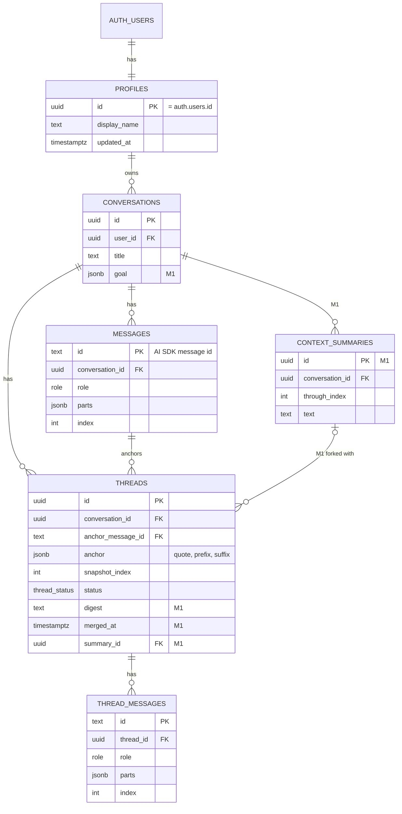

# funlern working doc

Shared copy: https://claude.ai/code/artifact/c40870de-a8d2-482f-8c9c-b1bdfd36cc17. Keep both in sync.

## Overview

funlern is an interactive learning app, not a general chat clone. You start by saying what you want to learn, set a minimal goal, then work through it: highlight any passage to ask about it in a side thread, answer clarifying questions and pop quizzes as cards, and earn progress as you go. The first user is me, learning faster; it doubles as a showcase.

Status: the backend is scaffolded and builds (auth, schema, chat and thread routes, Claude only). The UI is unstyled stubs, waiting on mocks. Nothing is committed yet.

## Scope and milestones

Three milestones: the POC proves side threads, the MVP adds the learning loop, and everything else waits until I have used it for real.

| Milestone | In scope | Done when |
| --- | --- | --- |
| M0 POC | Highlight to ask, side-thread rail, Claude only | I can pick apart one long answer with three or more threads |
| M1 MVP | Learning setup, ask-user cards, bring threads into main, context compaction | I use it for a week instead of Claude chat for one topic |
| Later | Pop quizzes, XP and streak, free-text grading, spaced review of missed concepts, concept mastery map, shareable sessions for the showcase, selectable tutor avatars (unlocked with XP first, paid later), bring-your-own models (DeepSeek, Kimi, GLM, OpenRouter) | Picked after M1 |
| Pinned | Web search tool with cited sources (see Web search) | Scheduled once a topic I study needs facts newer than the model's cutoff |

### Learning setup

A new session opens on "What do you want to learn?" plus four optional fields: goal (what you want to be able to do), current level (new, some, comfortable), depth (overview or deep dive), and quiz frequency (off, occasional, frequent). Stored as `goal` JSON on `conversations`. The model can refine it with an ask-user card in its first turn.

### Ask-user cards and quizzes

Both are AI SDK tools with no server `execute`: the model calls them and the client renders a card, like Claude's multiple-choice prompt.

- **`ask_user`**: a question with 2 to 4 options (label + one-line description), plus "something else" and skip. The answer goes back with `addToolOutput`; `sendAutomaticallyWhen` continues the turn.
- **`quiz`**: question, options, correct index, explanation, concept tag. The card grades locally, shows the explanation and returns the result to the model.
- **Answer key on the client:** acceptable for a single-user learning app. Strip it from the stream later if sessions become shared.

### Free-text answers

In M1 scope. The model grades each answer as correct, partially correct or incorrect. To keep grading consistent:

1. **Key points first.** When the model writes the question, it also writes 2 to 4 key points a good answer must cover. They stay hidden from the card.
2. **Separate grader call.** Grading runs without the conversation, so the model is not inclined to be generous to the user it has been teaching. It sees only the question, the key points and the answer, at temperature 0, with structured output.
3. **Score from the points.** The grader marks each key point covered or missing; the app maps all covered to correct, some to partially correct, none to incorrect.
4. **Show the reasoning.** The card shows which points were missed, and a "I think I'm right" button regrades or lets me override.

Known weak spots: answers that sound confident but are wrong, long answers scored higher than they deserve, and weaker open-weight models as graders. The grader model is configurable for that reason.

### When quizzes appear

The app sets the cadence; the model writes the quiz. With "occasional", every 4th assistant turn the server adds one line to that user message: "End with one quiz question on what we just covered." Questions asked in side threads are fed in as hints, because they mark what confused me. The cadence lives in the user message, not the system prompt, so the cached prefix does not change.

### Progress

XP comes only from quizzes: 10 for correct first try, 3 for correct after a miss. A streak counts consecutive days with at least one quiz answered. Both are derived from `quiz_attempts`, so there is no stats table to keep in sync. Per-concept accuracy from the same table drives "review this" later.

### What this changes in the build

- **Schema:** `conversations.goal` (JSON); new `quiz_attempts` (id, conversation id, message id, tool call id, concept, correct, attempts, answered at).
- **Threads must send the same tool definitions as main.** Tools sit at the front of the cached prefix, so a thread without them misses the cache. Threads set `toolChoice: "none"` instead.

### Web search (pinned)

Pinned, not scheduled. The tutor gets one `web_search` tool that we run ourselves, so it works with every model, including DeepSeek, Kimi and GLM. Provider-built search (Anthropic, OpenAI) only works with that vendor's models.

- **Backend:** Tavily, 1,000 free searches a month, then about $0.008 each. Google Custom Search is closed to new signups and shuts down on 2027-01-01.
- **Tool:** input `{ query }`; returns the top 5 results (title, URL, trimmed content). The server holds the key; bring-your-own search key later.
- **Limits:** a few searches per turn, a daily quota per user, results cached by query in Postgres.
- **Citations:** results render as source chips under the tutor message.
- **Context:** compaction drops old search results and keeps only what was cited.
- **When to search:** the model alone misses confident errors on niche facts, so we steer it: today's date and the model's cutoff in the system prompt, a search eagerness setting per topic, one grounding search when planning a lesson, and a "check this" button.
- **Side threads:** they run with `toolChoice: "none"` today, so they cannot search unless we change that.

## Data model

Five tables are built in code with a generated migration, not yet applied. Table names are plural to match Supabase's `auth.users`. `profiles` is our side of each account: one row per `auth.users` row, created by a signup trigger. Every `user_id` references `profiles`, so deleting a user cascades through all their data. M1 adds two tables and five columns (marked `M1`).

Threads point at both the conversation and the exact message they quote; `snapshot_index` marks where the forked context stops. In M1, `threads.summary_id` records which rolling summary was active when the thread was forked. XP and streaks are derived from `quiz_attempts`.

## Decisions

| Decision | Choice | Why |
| --- | --- | --- |
| Base | Own scaffold (create-next-app) | vercel/chatbot is locked to the AI Gateway, and most of its code is the artifacts feature |
| Chat UI | AI Elements (shadcn registry), restyled | Same components vercel/chatbot uses, without the rest of the app |
| Stack | Next.js 16, Tailwind v4, AI SDK 7, Drizzle | Current versions, all typed |
| Auth + DB | Supabase: email OTP or magic link, Postgres | One service for both |
| Data access | Drizzle as table owner; RLS on with no policies | Blocks the public Data API; every query filters by user id |
| Models | Claude only for the POC, from `ANTHROPIC_API_KEY`; bring-your-own models later | One provider key to manage; the removed BYO code is in commit e0f061b |
| Thread context | Frozen fork at the snapshot, same model as main | Shared prefix is a prompt cache hit |
| Thread instructions | In the user turn, not the system prompt | Keeps the cached prefix byte-identical |
| Accounts | Our own `profiles` table keyed to `auth.users`, filled by a signup trigger; table names plural | We own user data like names; plural matches Supabase's `auth.users` |
| Lint | @antfu/eslint-config | `process` stays global for Next env inlining |
| Prompts | TypeScript modules in the repo, versioned by git; no hosted prompt manager | Only developers edit them; typed arguments and diffs come free |
| Migrations | Drizzle generates into `supabase/migrations`; the Supabase CLI applies them. One migration per task, checked by `drizzle-kit check` and squawk | One runner that knows the auth schema; `db reset` and `db push` work locally and on hosted |
| Local dev | `supabase start` in Docker on ports 553xx; hosted values in `.env.remote` | Real Auth and Mailpit locally; 553xx avoids another local Supabase project on the defaults |
| Tools | Native tool calling via AI SDK `tool()` with zod schemas; one registry, no MCP | Every supported provider has tool calling; zod validates every call |

## Framework comparison

No open-source chat app has highlight-to-ask in a side thread. Keep our own scaffold, use AI Elements for the chat UI, and borrow patterns from LobeHub, big-AGI, LibreChat and NextChat. Researched 2026-10-02 from each repo's code and license.

| Project | License | Stack | Per-user keys | Threads / branching | Highlight or quote | Context compaction |
| --- | --- | --- | --- | --- | --- | --- |
| [LobeHub](https://github.com/lobehub/lobehub) | Community license: derivative works need a paid commercial license | Next.js 16, Drizzle, Postgres | Yes, encrypted vault | Threads in a right-side Portal, branched from a whole message; Notion-style comments | No | Yes, summary messages |
| [LibreChat](https://github.com/LibreChat-AI/LibreChat) | MIT | React + Vite, Express, MongoDB | Opt-in (`user_provided`) | Message tree, fork to new chat | Quote chips into the main thread | Yes, rolling summary (`summarization:`) |
| [Open WebUI](https://github.com/open-webui/open-webui) | BSD-3 + branding clause: no rebrand above 50 users | SvelteKit, FastAPI | Only if direct connections enabled | Message tree, fork | "Ask"/"Explain" buttons that only prefill the main input | Yes, token threshold |
| [big-AGI](https://github.com/enricoros/big-AGI) | MIT (hosted/auth layer private) | Next.js 15 Pages Router, MUI Joy, IndexedDB | Yes, 28 vendors | Branch into a split pane; Beam | Selection bubble: highlight, reply-with-quote | No; manual skip per message |
| [NextChat](https://github.com/ChatGPTNextWeb/NextChat) | MIT | Next.js as SPA, Zustand, no DB | Yes, in browser | Copy whole session | No | Yes, rolling summary (`summarizeSession`) |
| [Hugging Face chat-ui](https://github.com/huggingface/chat-ui) | Apache-2.0 | SvelteKit, MongoDB | No, server-wide | Retry/edit alternatives | No | No |
| [AnythingLLM](https://github.com/Mintplex-Labs/anything-llm) | MIT | React + Vite, Express, Prisma | No, admin env | Fork from a message | No | Keeps last 20, truncates the middle |
| [assistant-ui](https://github.com/assistant-ui/assistant-ui) (library) | MIT | React components on your own `useChat` | n/a | Branch picker | Selection toolbar + quote (text only, no offsets) | No |
| [AI Elements](https://github.com/vercel/ai-elements) (library) | Apache-2.0 | Copy-in shadcn components, stateless | n/a | Display only | No | No |
| [CopilotKit](https://github.com/CopilotKit/CopilotKit) (library) | MIT | Own runtime (AG-UI), not `useChat` | n/a | Thread drawer | No | No |

chatbot-ui (Next.js + Supabase) has been unmaintained since mid-2024.

Why not adopt one:

- **LobeHub** is the closest match: same stack, right-rail threads, per-user keys. Derivatives need a commercial license, and LobeHub can change its terms.
- **LibreChat** is the only full app with a permissive license and both quote and summarization, but it is Vite + Express + MongoDB at about 667k lines.
- **Open WebUI** is ruled out by the branding clause and the Svelte + Python stack.
- **big-AGI** has most of the UX pieces but uses the Pages Router and MUI Joy, and its auth layer is private.

What to borrow (MIT code can be copied with its license notice):

- **Thread data model and rail:** LobeHub's `threads` table (`sourceMessageId`, `parentThreadId`) and Continuation vs Standalone modes. Patterns only.
- **Selection bubble:** big-AGI `ChatMessage.tsx` and assistant-ui `SelectionToolbarPrimitive`. Ours adds character offsets for anchoring.
- **Compaction:** LibreChat's `retainRecent` settings and NextChat's `summarizeSession`.
- **Chat UI:** AI Elements over our own per-thread `useChat`.

## Work tracker

### M0 POC
- [x] Next.js + Tailwind scaffold, antfu lint
- [x] Supabase auth: email OTP, magic link, proxy
- [x] Schema, RLS, first migration
- [x] `/api/chat` with persistence
- [x] `/api/thread` frozen fork with cache marker
- [x] Claude via `ANTHROPIC_API_KEY`
- [ ] First commit and push
- [ ] Local run-through: `supabase start`, migrate, sign in, chat
- [ ] Install AI Elements, build chat shell from mocks
- [ ] Selection listener and "Ask" popover
- [ ] Highlight painting (CSS Custom Highlight API)
- [ ] Thread rail positioning and overlap

### M1 MVP
- [ ] Learning setup screen and `conversations.goal`
- [ ] `ask_user` tool and card
- [ ] Context compaction (rolling summary)
- [ ] Bring threads into main
- [ ] Conversation list and titles
- [x] Prompt and tool registry scaffold
- [ ] Tool-call repair
- [ ] Prompt version hash on messages, prefix snapshot test

### Later
- [ ] `quiz` tool, card and `quiz_attempts`
- [ ] Quiz cadence setting and thread-question hints
- [ ] XP and streak display

## Context management

vercel/chatbot has none: it sends the full history every turn. The AI SDK's `pruneMessages` only strips reasoning and tool calls. We build compaction ourselves.

Proposal: keep the last 20 messages verbatim and fold everything older into one rolling summary, compacted in batches.

1. **Trigger in batches.** Compact when the unsummarized tail passes 40 messages (or a token budget), back down to 20. The prefix stays byte-identical between compactions, so the prompt cache keeps hitting.
2. **What the model sees:** system prompt, then the summary as the first user message, then the messages after the summary point.
3. **Storage:** `context_summaries` table (id, conversation id, `through_index`, text, created time). Latest row is active; old rows stay so forks can replay them.
4. **When it runs:** after the response is saved (`onEnd`), so no added latency. A cheaper model is fine here.
5. **Threads:** each thread stores the summary id active at its snapshot, so the fork replays exactly what main saw.
6. **UI:** full history stays visible; at most a divider marks where the summary starts.

Count tokens rather than messages if answers run long: 20 long answers can exceed a small open-weight model's context window.

## Bring threads into main

In scope: a manual "Bring into main" button per thread. It condenses the thread into a short digest, and the next main turn carries it.

1. **Digest:** summarize the thread into 2 to 4 sentences (quote, question, what was learned or corrected). Store on the thread (`digest`, `merged_at`).
2. **Staging:** merged digests show as chips above the main input; the user can remove one before sending.
3. **Delivery:** digests ride in the user message as a `data-thread-digest` part, saved with that message. `convertToModelMessages` turns them into text via `convertDataPart`.
4. **Not the system prompt:** that would miss the cache every turn.
5. **Compaction:** digests are ordinary message content; the rolling summary absorbs them.
6. **Thread state:** a merged thread shows as merged and can stay open; merging again sends a new digest.

Schema change: `threads` gets `digest text` and `merged_at timestamptz`, plus the new `context_summaries` table. Automatic merging stays out of scope.

## Prompts and tools

Decided 2026-10-10: prompts and tools live in the repo as typed TypeScript, in `lib/ai/prompts/` and `lib/ai/tools/`. Scaffolded; the tools are not wired into the routes until the cards exist.

| Kind | Where it goes | Changes | Examples |
| --- | --- | --- | --- |
| System prompt | Start of the cached prefix | Once per conversation | Tutor persona, teaching style, learning goal, what injected tags mean |
| Tool definitions | Cached prefix | Only on deploy | `ask_user`, `quiz`, `web_search` (pinned) |
| Per-turn additions | Inside the user message | Every turn | Thread framing, quiz nudge, thread digests, rolling summary, today's date |
| Task prompts | Their own call | Per task | Grader, summarizer, digest, title, lesson planner, each with a zod output schema |

- **Layout:** `prompts/system.ts`, `prompts/turn.ts`, `prompts/tasks/*`; `tools/schemas.ts` holds definitions with no server code so client cards can import them, and `tools/index.ts` is the registry plus `FunlernUIMessage` types.
- **Templates:** plain functions with typed arguments, no `{{ }}` engine. Injected content is wrapped in tags the system prompt explains, with user text escaped.
- **Same tool set on every request.** Threads keep all tools and set `toolChoice: "none"`, so the prefix stays cached.
- **Valid tool JSON:** zod validates every call; `strict: true` where the provider supports it; `repairToolCall` re-asks once, then the error goes back as the tool result; flat schemas with enums and a `.describe()` per field.
- **Traceability:** a hash of the system prompt and tool definitions goes in each assistant message's metadata, and a snapshot test fails if the prefix changes by accident.

## Open questions

- [ ] Compaction trigger: message count (40 down to 20) or a token budget per model?
- [ ] Summary model: the conversation's own model, or a cheap default the user configures?
- [ ] Digest review: show the digest for editing before attaching, or attach as generated?
- [ ] Regenerating a main answer orphans its threads. Keep as detached, or delete?
- [ ] Hosted Supabase project: create now, or stay local until the UI exists?
- [ ] Quiz cadence: app-driven every N turns (proposed), or let the model decide when?
- [x] Decided: free-text answers are in M1, graded correct, partially correct or incorrect (see Free-text answers).
- [ ] Decided: XP exists per session and per user. Still open: how XP is earned and how the two relate.
- [ ] Avatars: only a picture, or a tutor persona with its own teaching style? Spend XP to unlock before adding real payments?
